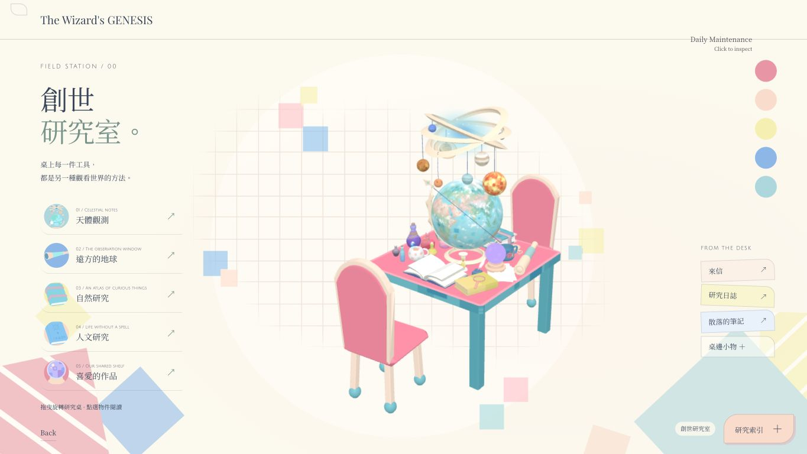
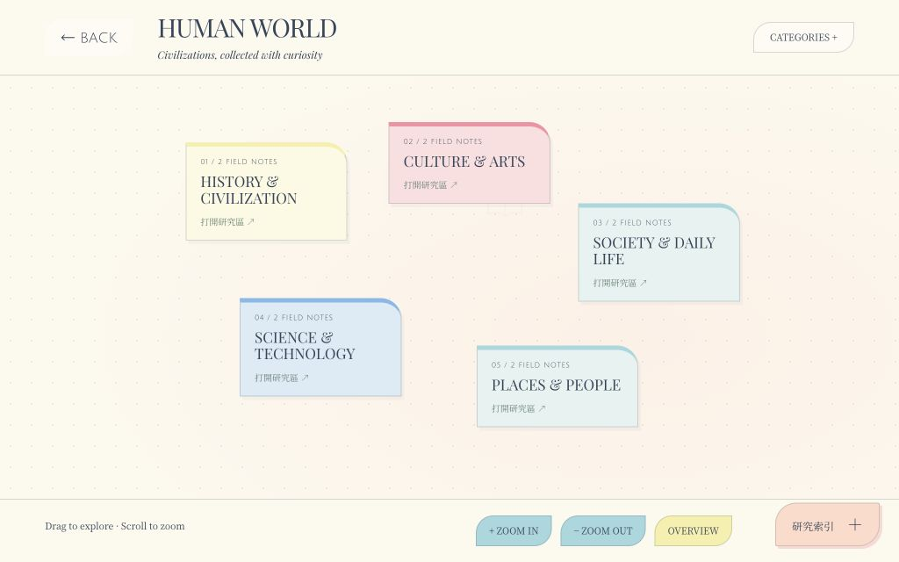
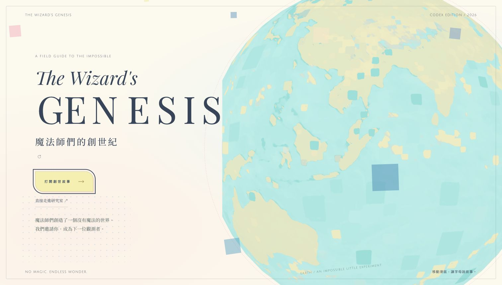

# Codex Edition 第二輪：彩色研究分頁

全站基底為 #FDF9EE，深墨色 #34465A 保持可讀性。五色為 #F691A6、#FFDBCA、#F6F0A9、#7FB9EC、#A2D8DE。

## 實作

- 入口、故事、Main、Big、Globe、Telescope、Natural、Human、Favorites、漫畫及導航與轉場重新整理色彩。
- 天體以薄荷青、望遠鏡以天空藍、自然以奶油黃、人文以蜜桃橘、收藏以草莓粉作為入口辨識。圖冊分類沿用不同研究內容的多色標記。
- Main 保留五次單格、hover 圓形、差分時間與最後波浪，只調整拼貼顏色；互動格改為奶油黃，提示同步更新。
- 現有 travelling sheet 加入三層觀測印章圓環；覆蓋與返回狀態仍由原有 state machine 管理。
- 索引內五個工具紙頁短暫錯開入場，並帶各自主題色 hover。
- 望遠鏡每次模式切換有 0.75 秒校準環。只重建裝飾 span，不重建地圖；不攔截滑鼠。
- 圖冊卡片 hover／focus 出現小摺角，閱讀面板局部揭紙，保留原有平移／缩放與閱讀內容。
- 收藏詳情以左緣為薄頁軸，perspective 1100 + rotateY 開展，保留關閉、選取同步與焦點還原。
- 新增裝飾均沒有額外計時器或持續 RAF；尊重 reduced-motion。保留第一輪視差、研究室聚焦及工具反應。
- 移除收藏插畫先前的 saturation 濾鏡；沒有改寫任何原畫或模型材質。

## 參數位置

- `src/edition/palette.js`：共用 JS 顏色与每頁主色。
- `src/edition/round2.css`：CSS 色票、色彩關係與有限次微動畫。
- `src/edition/config.js`：工具入口及第一輪動效參數。
- `src/components/main/revealConfig.js`：Main 拼貼色票與原有揭幕參數。

## 實際驗證

正式建置成功，674 modules，沒有新增依賴。既有大型 bundle 警告仍存在。
Chrome 正式建置預覽 4186：

- Main 完成全部五次點擊，前半段每次移除一格，最後完整撤除遮罩。
- 較小桌面 1024×640 與 1365×768 檢查關鍵頁面；人文圖冊 scrollWidth = viewportWidth = 1024。
- 自然研究：進入 LAND、閱讀 VOLCANO、關閉後立即 OVERVIEW。
- 收藏：Tiny Orbits 薄頁詳情、對話選取同步、關閉後立即 MOVIES。
- 望遠鏡：SATELLITE → GLOBE 快速切換，校準節點 pointer-events none，LOG 開啟／關閉。
- 天體：模型實際渲染，地球快捷按鈕將選取改為 Earth 並開啟研究筆記。
- 研究室：模型載入、來信開關、索引進入 Human，完成後兩個轉場容器皆 idle / pointer-events none。
- 索引工具依序入場，故事首頁及入口實際渲染。第二輪沒有再次走完所有漫畫與故事句子；第一輪完整測試紀錄仍保留。
- 已修正 lazy-loaded 圖冊樣式蓋掉分類色條的問題，computed border 確認符合奶油黃。
- 此輪已檢查的瀏覽器 console error/warn 為空。未做跨瀏覽器或 GPU/FPS 基準測試。

## 第一輪回復

第一輪封存在 `versions/round-1-20261011-122856.tar.gz`，排除 node_modules、dist、Git、快取，包含程式、配置與素材。完整性及素材比對在 `versions/round-1-manifest.json`。

安全回復方式：先將封存解壓至新的空資料夾，檢查後才替換 Codex Edition。不要將它解壓到原版 GENESIS。

```bash
mkdir -p /private/tmp/GENESIS-Round1-Restore
tar -xzf versions/round-1-20261011-122856.tar.gz -C /private/tmp/GENESIS-Round1-Restore
cd /private/tmp/GENESIS-Round1-Restore
npm ci
npm run dev
```

啟動前停止目前佔用 5186 的 Codex Edition 開發伺服器，或以 Vite CLI 指定其他本機埠。

## 尚存限制

原有劇情／研究文章占位內容及 Live2D 未新增；地圖仍依賴外部圖資，原始模型／字型仍偏大。未部署至正式網站。

原版隔離檢查：333 個檔案、無新增／刪除／修改，Git 狀態與開始時一致，詳見 `original-isolation-verification.json`。




