# Codex Edition 實作與驗證紀錄

驗證日期：2026-10-11。這是可執行的獨立網站版本，並非設計提案。沒有部署、切換原版分支或執行原版建置。

## 隔離

- 工作副本先建立於 `/private/tmp/GENESIS-Codex-Edition`，才開始修改。
- 原專案為 `/Users/remoanpu/Desktop/The Wizard's GENESIS`。
- 沒有複製原專案 `.git`、`node_modules`、建置快取或私密環境設定；副本透過 `npm ci` 安裝自己的依賴。
- 必要程式、素材、公開配置及 `reference/Big-leftside-reference.png` 均在副本內；原始插畫與模型保留。
- 三張主視覺的預覽版另置 `Art/Edition`，每張約 823 KB。原始差分仍保留。
- 字型僅保留實際使用的可變字型、英文斜體與 Julius Sans，所有字型授權保留；未使用的 29 份重複字重只從副本排除。
- 開始工作時記錄 333 個原版檔案 SHA-256、大小、修改時間與 Git 狀態。驗證結果見 `original-isolation-verification.json`，詳細基準為 `original-baseline.json`。

## 建置與程式檢查

- 獨立 `npm ci`：通過。
- `npm run build`：通過（Vite 8.3.0，672 個模組）。
- 開發版：127.0.0.1:5186；建置版：127.0.0.1:4186。連接埠與原站隔離。
- 修正進站地球資源為 Vite 可處理的 URL；建置版地球與研究室 GLB 已實際載入，沒有依賴原版的素材網址。
- 桌邊小物選單依模型載入狀態停用，避免尚未準備完成時點擊沒有回應。
- 模型物件反應沿用現有 RAF，不增加第二個 Three.js 渲染迴圈；取消 pointer 操作不再誤作點擊。
- 新事件、RAF、ResizeObserver、MutationObserver 與圖片切換計時器均有卸載清理。
- 所有新視覺、參數和工具資料集中於 `src/edition`；揭幕參數維持在 `components/main/revealConfig.js`。

建置有大型 chunk 提示：主 bundle 及 MapLibre 相關 bundle 約 1 MB，原始 Big 模型約 49 MB、中文字型約 50 MB。保留提示，沒有為了讓輸出安靜而隱藏它。這份版本沒有宣稱完成大型素材壓縮或 GPU 效能優化。

## 實際瀏覽器檢查

使用 Chrome，檢查過 931×619（正常視窗）、1024×640、1365×768、1440×900、1600×800。這些是測試案例，不是固定設計基準；未聲稱每個畫面在每種尺寸下都完成完整測試。

| 流程 | 實際結果 |
| --- | --- |
| 進站 | 建置版地球顯示、標題與兩個入口可用；頂部不再被 Main 導覽遮住 |
| 創世故事 | 完整讀過四頁、十三句旁白與翻書流程，再回到 Main；重新安排左側文字範圍，消除旁白與右側插畫重疊 |
| Main 5 格 | 1024×640 起始測試：第一格揭開前 91 格、完成後 90 格，臉部原格已移除；其他格未一起消失 |
| 表情 | 建置版驗證第一格後 `attention` 狀態，初始 78 格降為 77 格；接著 `wink` 保持到最後。完成後差分節點數為 0，原畫顯示 |
| Hover / focus | 實際以鍵盤焦點觸發同一擴散邏輯，看到圓形 scale 逐步增加；點擊承接已填滿的粉紅色，不重播填色 |
| Resize | 從 1024×640 改為 1440×900，臉部格維持揭開、下一步仍是第 2 步；遮罩範圍為 x=0、top=86、width=1440、height=814，完整抵達底部 |
| 最終波浪 | 建置版第 5 次揭開後檢查到 `phase=final`、8 格正式翻轉、61 格仍等待；實際 transform 包含 perspective(1100px) rotateY，之後遮罩完整卸載 |
| 研究室 | 五工具入口、模型顯示、小物件選單、貓咪杯聚焦、原介紹卡及放回研究桌均可用；來信可開啟／關閉 |
| 望遠鏡漫畫 | 完整走過 16 個順序步驟（5 個分鏡＋11 個對話），使用空白鍵前進並進入 Telescope；返回研究室後顯示已探索記號 |
| Globe | 天體下拉聚焦地球、洲別 Asia、故事對話均可開啟；新「地球」快捷鈕使選取值實際變成 earth |
| Telescope | 實際拖曳後位置從 23.500°,121.000° 改為約 16.940°,76.222°；切換 Satellite、開啟日誌並在副本 5186 來源新增 QA 收藏 |
| Natural / Human | 分類聚焦、文章閱讀、關閉、總覽／縮放和返回都可用；1024×640 的頁面 clientWidth 與 scrollWidth 都是 1024，未產生額外橫向捲軸 |
| Favorites | 開啟 Tiny Orbits 後選取與對話同步；關閉詳情後立即點 MOVIES，確認 aria-pressed=true，退場圖層沒有吃掉點擊 |
| 共通索引 | 開啟、跨頁導航、Shift+Tab 循環到最後一個按鈕、Escape 關閉及焦點返回；關閉後立即開來信仍成功 |

最終建置版測試流程的瀏覽器錯誤紀錄為空。較早的開發版地圖曾出現 `calculateFogMatrix is not supported on globe projection` 警告，但地圖操作可用；不把它描述成已完成跨瀏覽器無錯驗證。

## 改造重點與保留

1. 進站不只是顯示標題，而是把地球放入天文觀測盤；書本旁白留有自己的空間與頁次。
2. Main 是可翻開的世界封面；完整原畫、五次單格操作與表情差分仍是核心。
3. Big 把五件研究工具變成可發現的探索路線；小物件仍保有原本的鏡頭聚焦與介紹卡，新增鍵盤入口。
4. Globe 與 Telescope 有不同的觀測語言：前者是刻線天體盤與觀測紙，後者是圓形鏡片與動態座標。
5. 空間圖冊的紙籤不隨鏡頭縮成小字；分類導航與可拖曳的研究空間共同保留。
6. 索引、卡片、紙張與工具各自有不同的動作，沒有把所有頁面統一為同一種淡入。

## 尚未完成／未實測

- 保留原本的開發文章、虛構作品占位與空白介紹卡，沒有擅自增加角色設定或正式研究內容。
- 不把漫畫插圖認作原本 placeholder 學生的正式肖像；作品區的 Live2D 尚未接入。
- 地圖不是街景，外部地圖、地形與衛星資料需要網路。
- 實測集中於 Chrome 桌面；Safari、Firefox、觸控、完整鍵盤流程、螢幕閱讀器、低階 GPU、長時間效能與逐幀動畫量測尚未完成。
- reduced-motion 的新轉場、紙片與揭幕已有處理，但原本的小物件鏡頭聚焦仍保留其動作。
- 網址 `?edition=...` 為獨立版本的直接預覽入口，不是新增完整 History Router。正式展示可直接從 `/` 的進站流程探索。

## 成果截圖

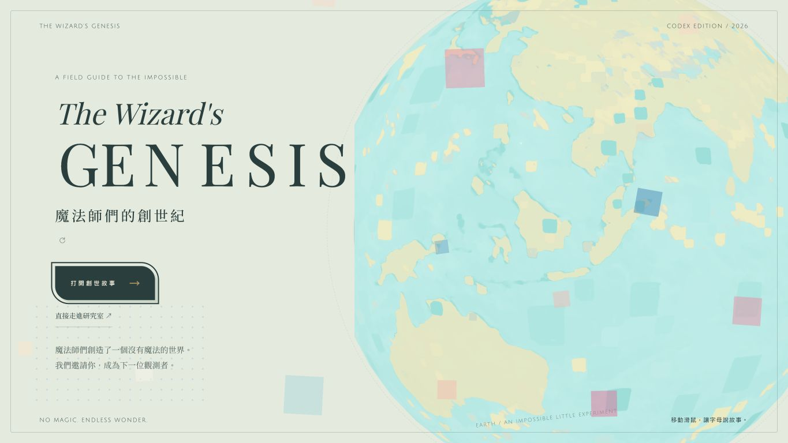
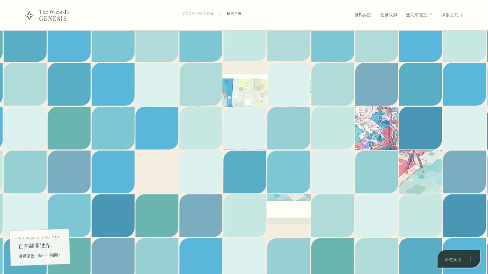
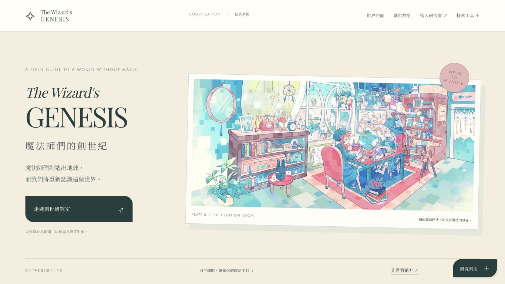
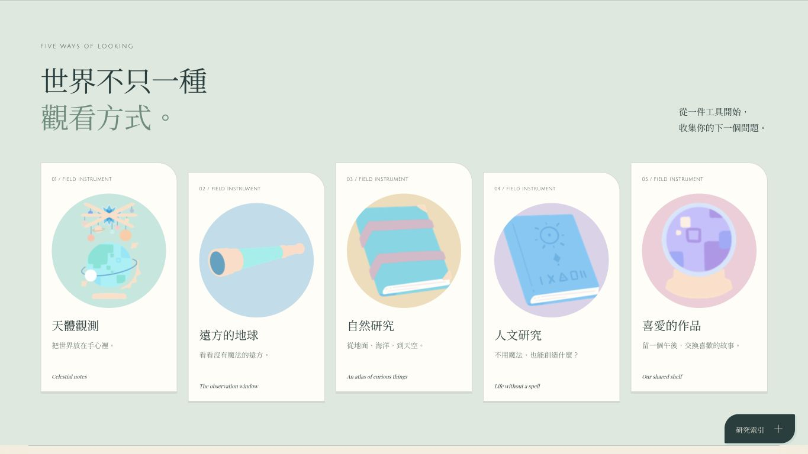
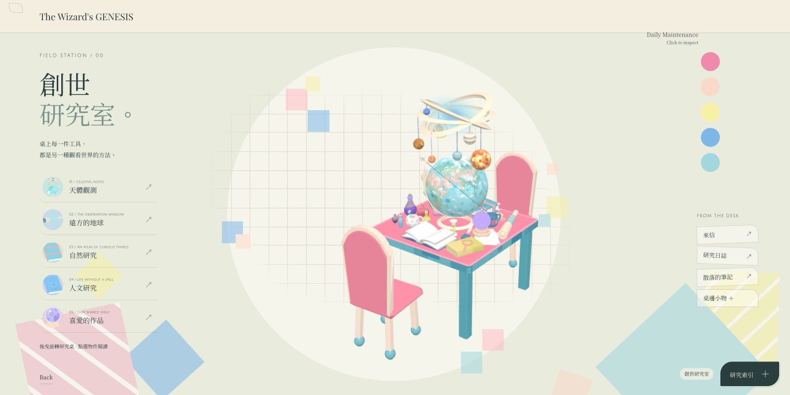
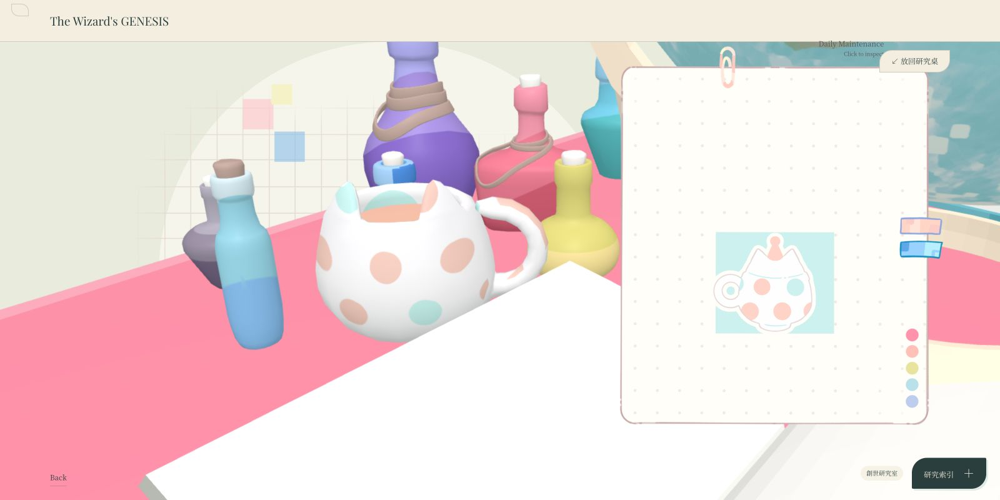
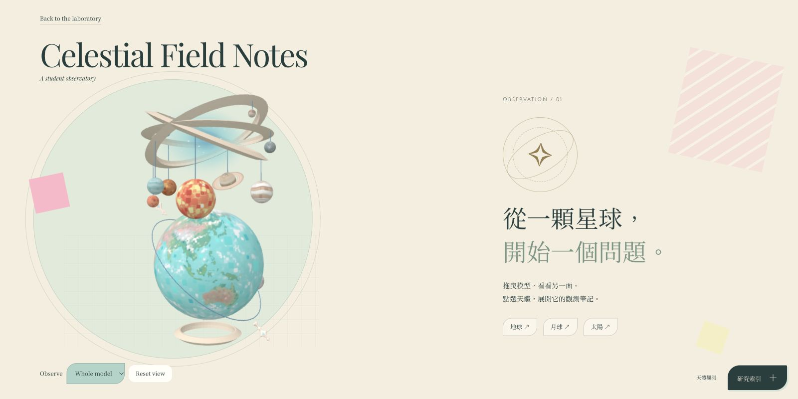
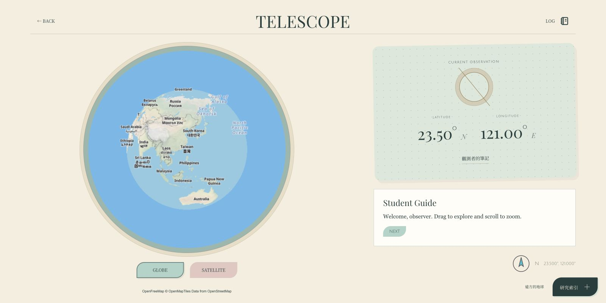
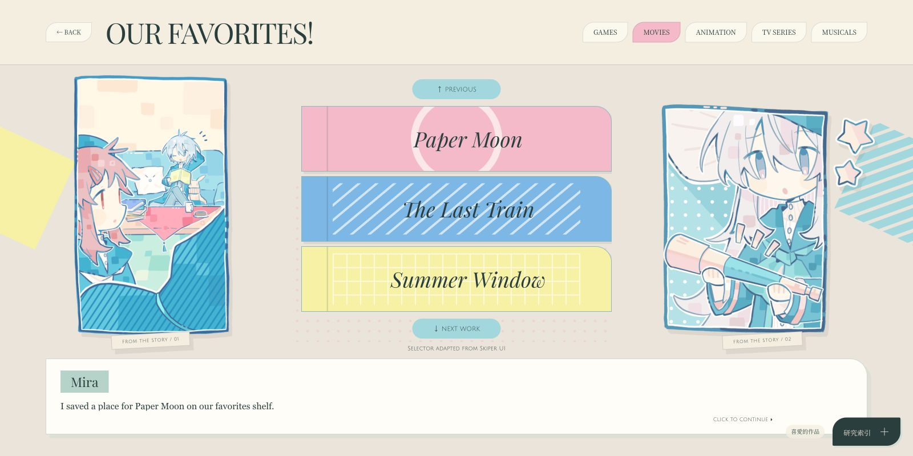
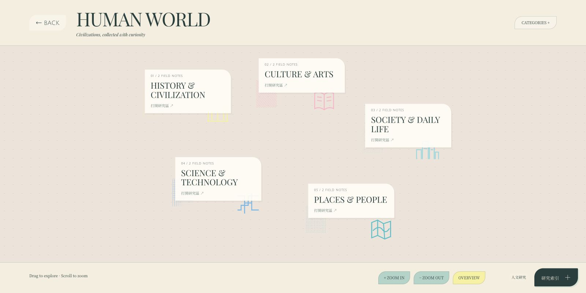
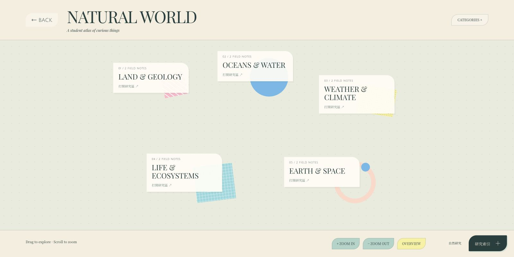
